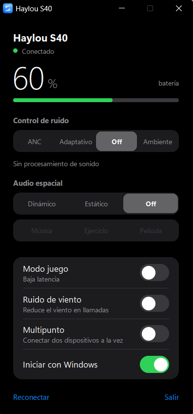

# Haylou S40 para Windows

Pequeña aplicación de escritorio, en español, para ver el estado y controlar unos auriculares **Haylou S40** desde Windows, algo que el fabricante solo ofrece en su app para celular.

> Proyecto no oficial, sin relación con Haylou. Se probó con un único par de auriculares S40; otros modelos o versiones de firmware pueden comportarse distinto. Úsalo bajo tu propia responsabilidad.

## Captura

<p align="center"></p>

## Qué hace

- Muestra la **batería** y el estado de conexión, y se refresca sola.
- **Control de ruido**: ANC, ANC adaptativo, Off y Sonido ambiente.
- **Audio espacial**: Dinámico, Estático y Off, con el escenario (Música, Ejercicio, Película).
- Interruptores para **modo juego**, **reducción de ruido de viento** y **multipunto**.
- Icono en la bandeja con el porcentaje de batería y el modo activo (clic derecho para cambiar de modo).
- **Aviso de batería baja** (20 % y 10 %) como notificación de Windows; se activa o desactiva desde el menú de la bandeja.
- Si abres la app otra vez mientras está en la bandeja, muestra la ventana ya abierta.
- Tema claro/oscuro según Windows, animaciones suaves (respeta «reducir animaciones»), reconexión automática y opción de iniciar con Windows.

Lo que **no** incluye: el EQ del auricular (los valores no coinciden con ningún nombre conocido), LDAC (Windows no usa ese códec y el cambio reinicia los auriculares) y los niveles de ANC (en las pruebas no produjeron ningún cambio medible). Detalles en [docs/PROTOCOLO-S40.md](docs/PROTOCOLO-S40.md).

## Descargar (sin instalar Python)

En la pestaña [Releases](../../releases/latest) descarga **Haylou-S40-Windows.zip**, descomprímelo y abre **Haylou S40.exe**. No necesitas Python. Como el programa no está firmado, Windows puede mostrar un aviso de SmartScreen: pulsa «Más información» y «Ejecutar de todas formas».

## Requisitos

- Windows 10/11 con Bluetooth y los auriculares ya emparejados con el PC.
- Python 3.10 o superior (solo si la ejecutas desde el código o generas el instalable tú mismo).

## Usarla desde el código

```bash
pip install -r requirements.txt
python haylou_s40.py
```

## Generar el instalable (opcional)

```powershell
powershell -ExecutionPolicy Bypass -File build.ps1
```

Empaqueta la app con PyInstaller, la instala para tu usuario en `%LOCALAPPDATA%\Programs\HaylouS40`, crea el acceso directo en el menú Inicio y un desinstalador (también aparece en «Aplicaciones» de Windows). No requiere permisos de administrador. Si no hay `icon.ico`, se genera un icono genérico; si pones tu propia imagen como `icon_source.jpg`, se usa esa.

## Cosas que conviene saber

- **Solo un dispositivo puede controlar los auriculares a la vez.** Si la app oficial del celular (o una segunda copia de esta app) está conectada, los auriculares esconden sus servicios de control y esta app mostrará que no responden. Cierra la otra app y pulsa «Reconectar». Con el **multipunto** activado el celular puede conectarse a la vez para el audio.
- La primera conexión puede tardar entre 10 y 20 segundos.
- Si algo falla, el registro está en `%APPDATA%\HaylouS40\haylou.log`. Arrancando con `--debug` (`python haylou_s40.py --debug`) se guardan también las tramas BLE enviadas y recibidas.
- La app habla con los auriculares por Bluetooth LE mientras siguen conectados como audio normal; no cambia nada del audio de Windows.

## Cómo funciona

Los auriculares usan un protocolo propio sobre BLE (chipset BES). Los comandos se escriben en la característica `cf05` y las respuestas llegan por `ae02`. Todo el protocolo, con las tramas reales capturadas, está en [docs/PROTOCOLO-S40.md](docs/PROTOCOLO-S40.md) y en `s40_protocol.py` (funciones puras, con pruebas en `test_protocol.py`).

```bash
python test_protocol.py
```

## Créditos

El formato de las tramas parte del trabajo de ingeniería inversa de
[revolutedigital/haylou-s30-pro-windows](https://github.com/revolutedigital/haylou-s30-pro-windows)
(licencia MIT, © 2026 Igor Silveira), pensado para el Haylou S30 Pro. Esta aplicación es una reescritura independiente, con otro canal BLE y otras funciones, verificada contra un S40 real.

## Licencia

[MIT](LICENSE).
